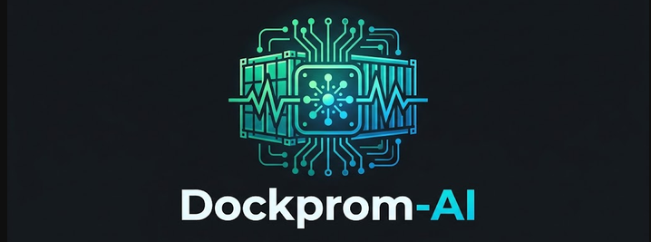
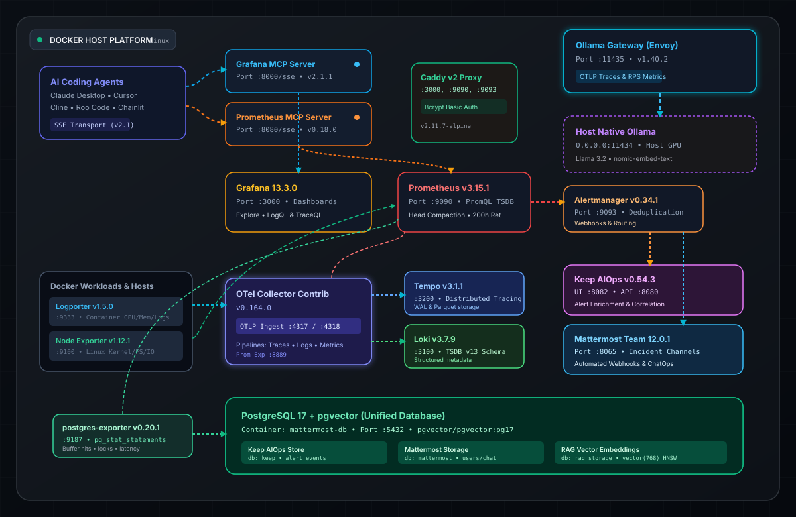
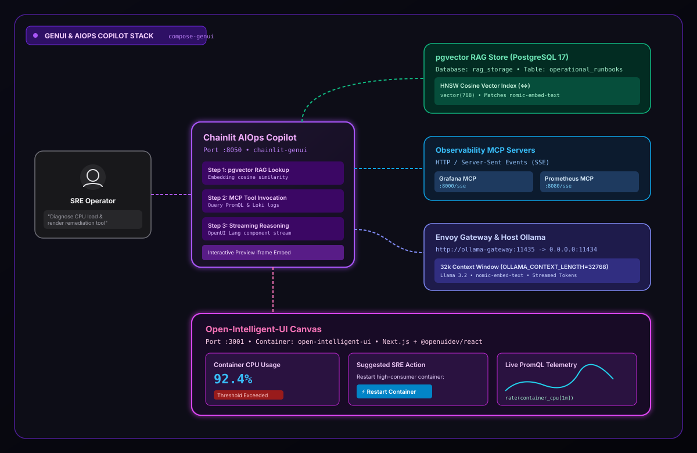

<p align="center">
  <picture>
    
  </picture>
</p>

<p align="center">
  <b>Production-Grade AI Observability &amp; AIOps Platform</b><br>
  <sub>Prometheus • Grafana • Loki • Tempo • OpenTelemetry • Host Ollama Gateway • MCP Servers • pgvector</sub>
  <sub>OpenUI • OpenIntelligence UI • Chainlit</sub>
</p>

<p align="center">
  <a href="https://github.com/grafana/mcp-grafana/actions/workflows/unit.yml"></a>
  <a href="https://github.com/grafana/mcp-grafana/actions/workflows/integration.yml"></a>
  <a href="https://github.com/grafana/mcp-grafana/actions/workflows/e2e.yml"></a>
</p>

---

### Overview: **Dockprom-AI**
**Dockprom-AI** is a production-grade, out-of-the-box monitoring, tracing, and AIOps observability stack designed for Docker hosts, containers, and LLM applications. It modernizes the classic [stefanprodan/dockprom](https://github.com/stefanprodan/dockprom) architecture by incorporating native AI agent interfaces via the Model Context Protocol (MCP), local host-level LLM inference, vector-enabled incident storage, and generative UI capabilities.

---

### Core Architecture & Components

The repository is structured into two main layers:

#### 1. Core Observability & AIOps Stack (`compose.yaml` / `compose.yml`)

* **Metrics & Monitoring**:
* **Prometheus v3.15.1**: Core metrics database and PromQL query engine.
* **Alertmanager v0.34.1**: Deduplication, grouping, and notification routing for alerts.
* **Pushgateway v1.10.0**: Ingestion acceptor for ephemeral and batch jobs.
* **Node Exporter v1.12.1**: Linux kernel, host hardware, and system OS metrics.
* **Logporter 1.5.0**: Modern, lightweight container metrics exporter and log shipper (replacing cAdvisor) with a built-in dashboard UI.

* **Logs & Distributed Tracing**:
* **Loki 3.7.9**: Scalable structured log aggregation utilizing TSDB schema v13
* **Tempo 3.1.1**: High-throughput distributed tracing backend.
* **OpenTelemetry Collector Contrib 0.164.0**: Unified pipeline receiving OTLP traces, logs, and metrics (via ports `4317` gRPC and `4318` HTTP).

* **Dashboards & Edge Ingress**:
* **Grafana 13.3.0**: Pre-provisioned dashboards covering Logporter, Node Exporter, PostgreSQL, OpenTelemetry pipelines, and MCP server health.
* **Caddy 2.11.7**: Edge reverse proxy terminating bcrypt-hashed basic authentication for exposed services.

* **Incident Management & Collaboration**:
* **Keep AIOps v0.54.3**: Incident correlation, noise reduction, and automated alert remediation platform.
* **Mattermost Team Edition 12.0.1**: Incident response collaboration workspace supporting webhook alert integration.

* **Database & Persistence**:
* **pgvector (PostgreSQL 17)**: Unified persistence layer for Keep, Mattermost, and vector embeddings storage (`rag_storage`).
* **Postgres Exporter v0.20.1**: Database engine monitoring with `pg_stat_statements` enabled.

* **AI Telemetry & MCP Endpoints**:
* **Ollama Gateway (Envoy v1.40.2)**: Reverse proxy running on port `11435` that bridges containers to native host Ollama (`host.docker.internal:11434`), collecting latency statistics and OTLP traces.
* **Grafana MCP Server 2.1.1**: Official Model Context Protocol server exposing Grafana dashboard and Loki query tools via Server-Sent Events (SSE) on port `8000`.
* **Prometheus MCP Server v0.18.0**: Official MCP server exposing PromQL tools via SSE on port `8080`.
---

#### 2. Generative UI & Copilot Companion Layer (`compose-genui.yaml`)

Designed to run alongside the core stack on the shared `monitor-net` Docker network:

* **Chainlit AIOps Copilot (`:8050`)**: A Python-based conversational SRE assistant orchestrating multi-step incident triage, retrieving runbooks via cosine similarity search in `pgvector`, executing queries through the MCP servers, and streaming reasoning steps.
* **Open-Intelligent-UI (`:3001`)**: A standalone Next.js application implementing the Thesys OpenUI streaming framework (`@openuidev/react`) to dynamically render interactive diagnostic widgets, forms, and charts generated by the LLM.

---

### Key Highlights & Features

* **Works Out-of-the-Box**: Includes automated host provisioning scripts (`install-host-prereqs.sh`) for Docker Engine, Docker Compose, and native host Ollama setup.
* **Hardware-Accelerated LLMs**: Runs Ollama directly on the host for direct GPU access without Dockerized CUDA/ROCm complications.
* **RAG-Ready Incident Management**: Combines `pgvector` with OpenTelemetry and PromQL to ground AI agent recommendations directly in live cluster metrics, logs, and historical postmortems.
* **Generative UI**: Combines Chainlit + OpenUI + OpenIntelligent-UI

--- 

## Pre-Configured Grafana Dashboards

Dockprom-AI provisions dashboards out-of-the-box using the modern Grafana provisioning schema (`grafana/provisioning/dashboards/dashboards.yml`). Dashboards are sourced from official upstream releases and Grafana Labs repositories.

### Dashboard Manifest

| Category | Dashboard Name | Grafana Labs ID / Source | Datasource(s) | Description |
| :--- | :--- | :--- | :--- | :--- |
| **Container & Host** | **Logporter Docker Exporter** | [`23848`](https://grafana.com/grafana/dashboards/23848-docker-exporter-logporter/) | Prometheus, Loki | Official Logporter dashboard: CPU, memory, volume sizes, restart counts, image update alerts, and embedded Loki container logs. |
| **Container & Host** | **Node Exporter Full** | [`1860`](https://grafana.com/grafana/dashboards/1860-node-exporter-full/) | Prometheus | Comprehensive host hardware/OS telemetry: CPU usage by core, memory commit, disk I/O latency, network traffic, and system load. |
| **AI & MCP Observability** | **MCP Server Observability** | [`25252`](https://grafana.com/grafana/dashboards/25252-mcp-server-observability/) | Prometheus, Loki, Tempo | Full-stack monitoring for `mcp-grafana` and `prometheus-mcp`: SSE sessions, message rates, JSON-RPC errors, tool invocation latency, and execution logs. |
| **AI & LLM Gateway** | **Envoy Ollama Proxy** | Custom / Envoy Stats | Prometheus, Tempo | Request throughput, p50/p95/p99 inferencing latencies, HTTP error rates, and OTLP traces for host Ollama requests. |
| **Telemetry Ingestion** | **OpenTelemetry Collector** | [`15983`](https://grafana.com/grafana/dashboards/15983-opentelemetry-collector-telemetry/) | Prometheus | Collector operational pipeline metrics: receiver queue sizes, batch processor latency, export drops, and data transmission throughput. |
| **Stack Health** | **Prometheus 3.x System Overview** | [`3662`](https://grafana.com/grafana/dashboards/3662-prometheus-2-0-overview/) | Prometheus | Scraping health, TSDB compaction rate, ingestion head chunks, sample scrape rates, and query latency percentiles. |
| **Stack Health** | **Loki Logging Stack Health** | [`13407`](https://grafana.com/grafana/dashboards/13407-loki-dashboard/) | Prometheus, Loki | Chunks stored, stream indexing status, query throughput, per-tenant volume rates, and flush operations. |
| **Stack Health** | **Tempo Traces & Storage** | [`15984`](https://grafana.com/grafana/dashboards/15984-tempo-operational-dashboard/) | Prometheus, Tempo | Ingestion block generation, WAL size, span compaction schedules, and search request performance. |

---

### Automated Dashboard Provisioning Script

Run this command prior to spinning up the stack to pull the dashboards directly into Grafana's provisioned directory:

```bash
mkdir -p grafana/provisioning/dashboards

# 1. Official Logporter Dashboard (ID: 23848)
curl -fsSL [https://grafana.com/api/dashboards/23848/revisions/latest/download](https://grafana.com/api/dashboards/23848/revisions/latest/download) \
  -o grafana/provisioning/dashboards/logporter.json

# 2. Node Exporter Full (ID: 1860)
curl -fsSL [https://grafana.com/api/dashboards/1860/revisions/latest/download](https://grafana.com/api/dashboards/1860/revisions/latest/download) \
  -o grafana/provisioning/dashboards/node-exporter-full.json

# 3. MCP Server Observability (ID: 25252)
curl -fsSL [https://grafana.com/api/dashboards/25252/revisions/latest/download](https://grafana.com/api/dashboards/25252/revisions/latest/download) \
  -o grafana/provisioning/dashboards/mcp-server-observability.json

# 4. OpenTelemetry Collector Ingestion Pipeline (ID: 15983)
curl -fsSL [https://grafana.com/api/dashboards/15983/revisions/latest/download](https://grafana.com/api/dashboards/15983/revisions/latest/download) \
  -o grafana/provisioning/dashboards/otel-collector.json

# 5. Prometheus System Overview (ID: 3662)
curl -fsSL [https://grafana.com/api/dashboards/3662/revisions/latest/download](https://grafana.com/api/dashboards/3662/revisions/latest/download) \
  -o grafana/provisioning/dashboards/prometheus-overview.json

# 6. Loki Operations Dashboard (ID: 13407)
curl -fsSL [https://grafana.com/api/dashboards/13407/revisions/latest/download](https://grafana.com/api/dashboards/13407/revisions/latest/download) \
  -o grafana/provisioning/dashboards/loki-operations.json

# 7. Tempo Traces Engine Overview (ID: 15984)
curl -fsSL [https://grafana.com/api/dashboards/15984/revisions/latest/download](https://grafana.com/api/dashboards/15984/revisions/latest/download) \
  -o grafana/provisioning/dashboards/tempo-operations.json
```
---

### Architecture

The diagrams are stored with the Docusaurus static assets so the same files are
rendered on GitHub and in the documentation site.

#### Core observability and AIOps stack

<p align="center">
  
</p>

#### Generative UI and AIOps copilot stack

<p align="center">
  
</p>

See [`README_GENUI.md`](README_GENUI.md) for details about the Generative UI
companion stack.
